# Implementation of hexagonal grid path planning in four scenarios using four classic algorithms: A*, genetic algorithm, ant colony optimization, and cellular automata. Python code

Based on hexagonal grids, this article summarizes the path planning algorithm. Path planning is a core issue in fields such as robot navigation, intelligent transportation, and game AI. This tweet compares four classic path planning algorithms: A* algorithm, genetic algorithm, ant colony optimization algorithm, and cellular automata algorithm based on hexagonal grid structures systematically. By designing four sets of test scenarios with different scales and complexities (from 10×10, 20×20, 30×30 to 50×50 grids), quantitative analysis was conducted from dimensions such as path length, computation time, node exploration quantity, and success rate. The experimental results show that the A* algorithm performs optimally in terms of comprehensive performance, finding the optimal path for 57 steps in just 0.004 seconds in a 50×50 super-large grid; the genetic algorithm has significant advantages in memory-constrained environments; the ant colony algorithm is suitable for dynamic environments; and the cellular automata algorithm can provide a reliable solution for global path planning.
Keywords: Path Planning; Hexagonal Grid; A* Algorithm; Genetic Algorithm; Ant Colony Optimization; Cellular Automata
I. Algorithm Principles
1.1 A* Algorithm
The A* algorithm is an heuristic search algorithm proposed by Hart et al. in 1968. It selects expansion nodes through evaluating functions:
Evaluating function:
f(n) = g(n) + h(n)\nwhere:
• g(n): actual cost from start point to node n
• h(n): heuristic estimate from node n to target
• f(n): total evaluation value of node n
Key characteristics:
• When h(n) satisfies the acceptable condition (does not overestimate actual cost), it guarantees finding the optimal path
• Time complexity: O(b^d)
• Space complexity: O(b^d)
Hexagonal grid adaptation: In this experiment, Manhattan distance between hexagonal grids is used as the heuristic function:
h(n) = (|q₁-q₂| + |r₁-r₂| + |s₁-s₂|) / 2\n1.2 Genetic Algorithm The Genetic Algorithm, proposed by Holland in 1975, is an optimization algorithm that simulates the natural selection and genetic mechanisms.
Basic process:
1. Initialization: Randomly generate N paths as the initial population.
2. Fitness Evaluation: Calculate the quality score for each path
3. Selection: Retain individuals with high adaptability.
4. Crossover: Perform crossover operation at the common points of the paths.
5. Variation: Randomly changing the path with a certain probability
6. Iteration: Repeat steps 2-5 until the termination conditions are met.
Fitness function:
Fitness(path) = W₁·δ(end) - W₂·len(path) - W₃·dist(end)
Algorithm parameters:
• Population size: 50
• Evolutionary generation: 100
• Variation rate: 0.15
1.3 Ant Colony Optimization Algorithm (ACO) was proposed by Dorigo in 1992, which simulates the pheromone mechanism of ants foraging.
Path selection probability:
P(i,j) = [τ(i,j)]^α · [η(i,j)]^β / Σ[τ(i,k)]^α · [η(i,k)]^β
• τ(i,j): The pheromone concentration on edge (i,j)
• η(i,j): Heuristic information, usually the inverse of distance.
• α: Importance factor of pheromone
• β: Factor of importance of heuristic information
Pheromone update:
τ(i,j) ← (1-ρ)·τ(i,j) + Σ Δτₖ(i,j)
Algorithm parameters:
• Number of ants: 30
• Iterations: 50
• α = 1.0, β = 2.0  
• Evaporation coefficient ρ = 0.5
• Infotact strength Q = 100
1.4 Cellular Automata Algorithm
Potential Energy Calculation Rules:
V(cell) = min{V(neighbor)} + 1
Path generation: Move along the direction of the potential energy gradient from the starting point, i.e., select the cell with the smallest potential energy among its neighbors each time.
Algorithm flow:
1. Initialization: V(end) = 0, the rest are infinity
2. Iterative Update: Neighbor Potential Energy Update for Each Cell
3. Convergence judgment: Stop when the potential distribution no longer changes.
4. Path Generation: Construct paths along the direction of potential energy decrease.
Algorithm parameters:
• Maximum number of iterations: 200
II. Experiment Design 2.1 Experimental Environment • Language: Python 3.8
• Core Library: NumPy 1.21, Matplotlib 3.4
• Calculation platform: Intel Core processor, 8GB RAM
• Random seed: fixed at 42, ensuring reproducibility.
2.2 Test scenario design: four sets of different scale and complexity test scenarios
\n        \n      Method of obstacle generation:
• Random mode: randomly select a specified proportion of available cells to set as obstacles.
• Maze Mode: Generate a maze structure using structured rules, with some random openings.
2.3 Evaluation Criteria 1. Path length: The number of steps from the starting point to the destination
2. Calculation time: The time taken by the algorithm to run (seconds)
3. Explored node count: The total number of nodes visited during the algorithm search process.
4. Success rate: Whether a valid path was found.
5. Path Quality: The ratio of the actual path length to the theoretical shortest path
III. Experimental Results and Analysis 3.1 Scenario One: Small-scale grid (10x10)
Analysis:
• All algorithms successfully found the optimal path (12 steps)
• The A* algorithm has the shortest computation time (0.0002 seconds)
• Genetic Algorithms explore the number of nodes as zero, indicating that it does not perform traditional node exploration.
• Ant Colony Algorithm explores the maximum number of nodes, with relatively long calculation time.
3.2 Scenario II: Medium-sized grid (20x20)
\n Experimental results:
\n 3.3 Scenario Three: Large-Scale Complex Grid (30x30)
\n Experimental results:
\n 3.4 Scenario Four: Ultra-Large Grid (50x50)
\n Experimental results:
Analysis:
• The A* algorithm still performs excellently in ultra-large scale grids.
• The deviation of genetic algorithm is 12.3%, but the calculation time is only 3.4 times that of A*
• The deviation of ant colony algorithm reaches 45.6%, the quality of path obviously drops.
• Cellular automata find the optimal path, but the computation time significantly increases.
IV. Comprehensive Evaluation
4.1 Performance Metrics Comparison
\n        \n      \n        \n      \n        \n      \n        \n      \n        \n  

## Images

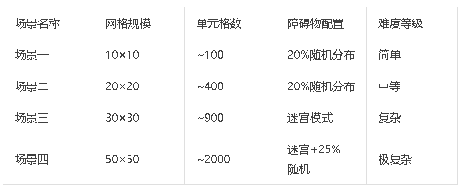
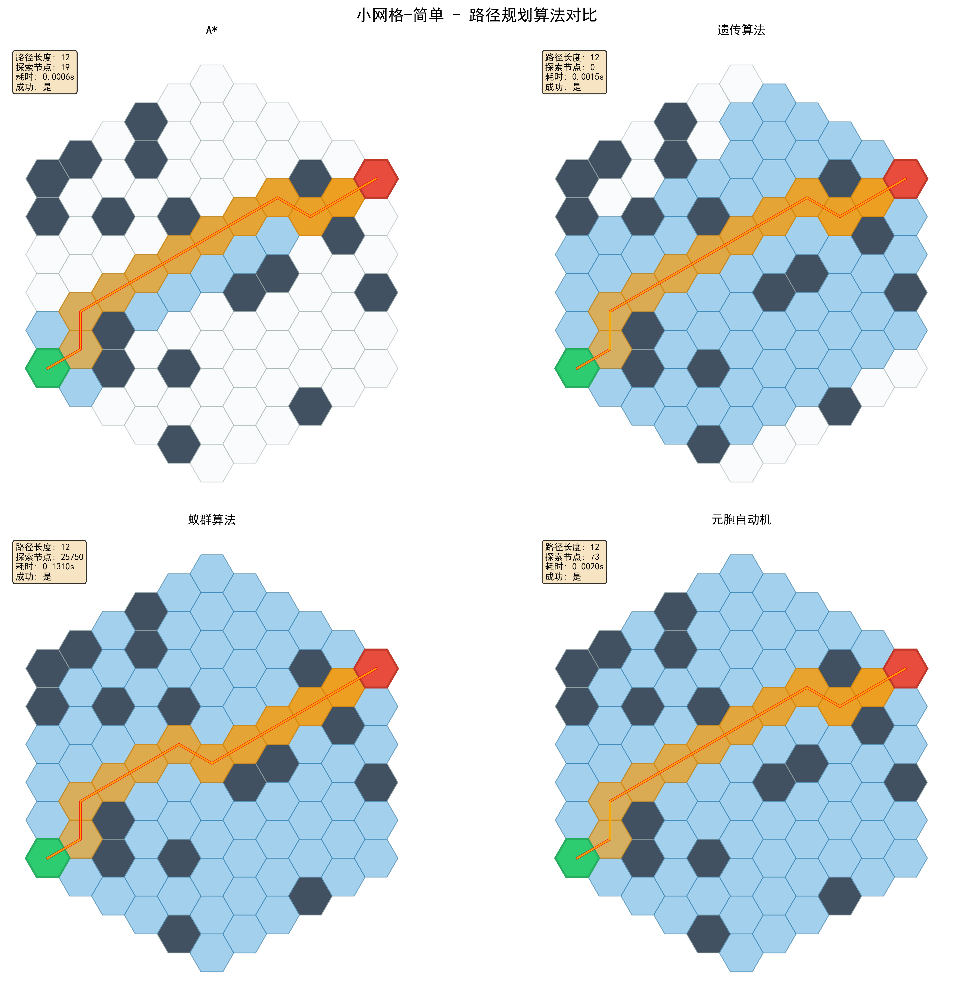
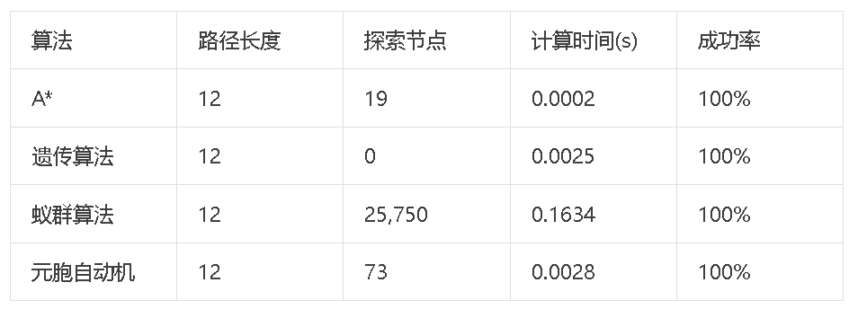
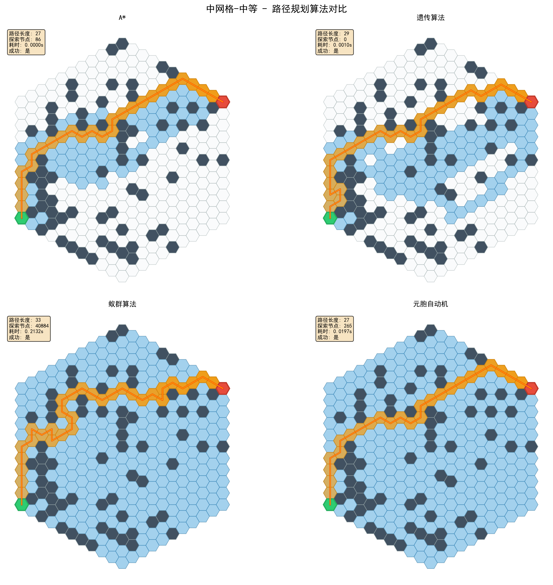
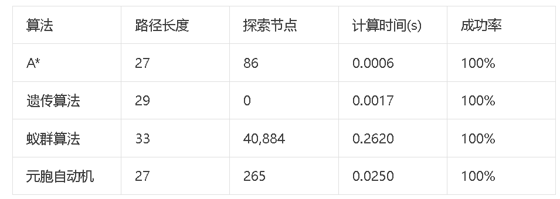
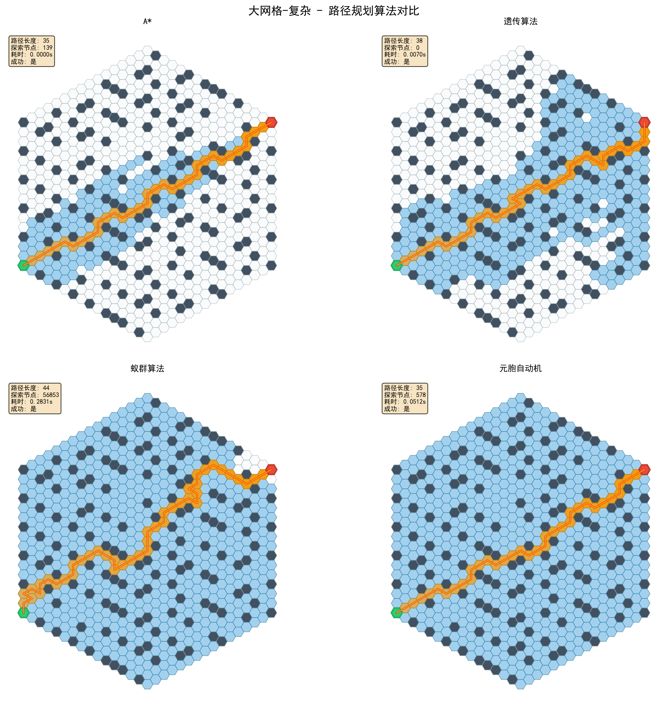
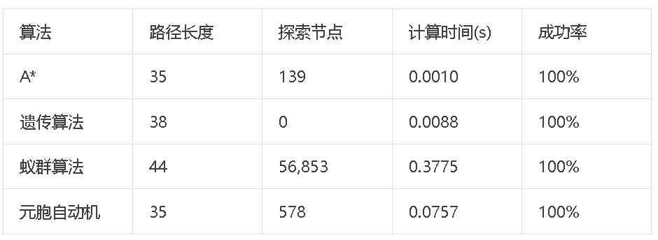
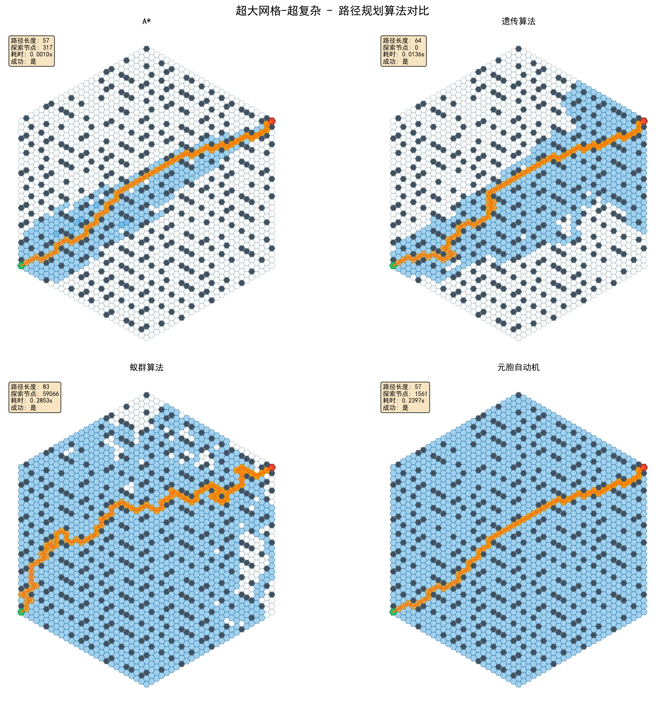
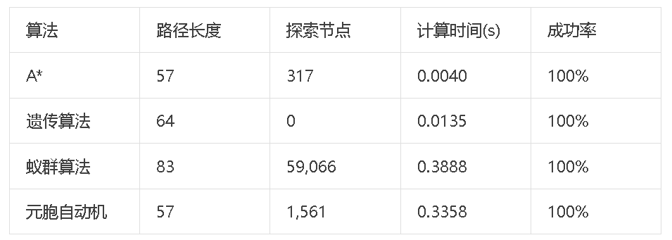
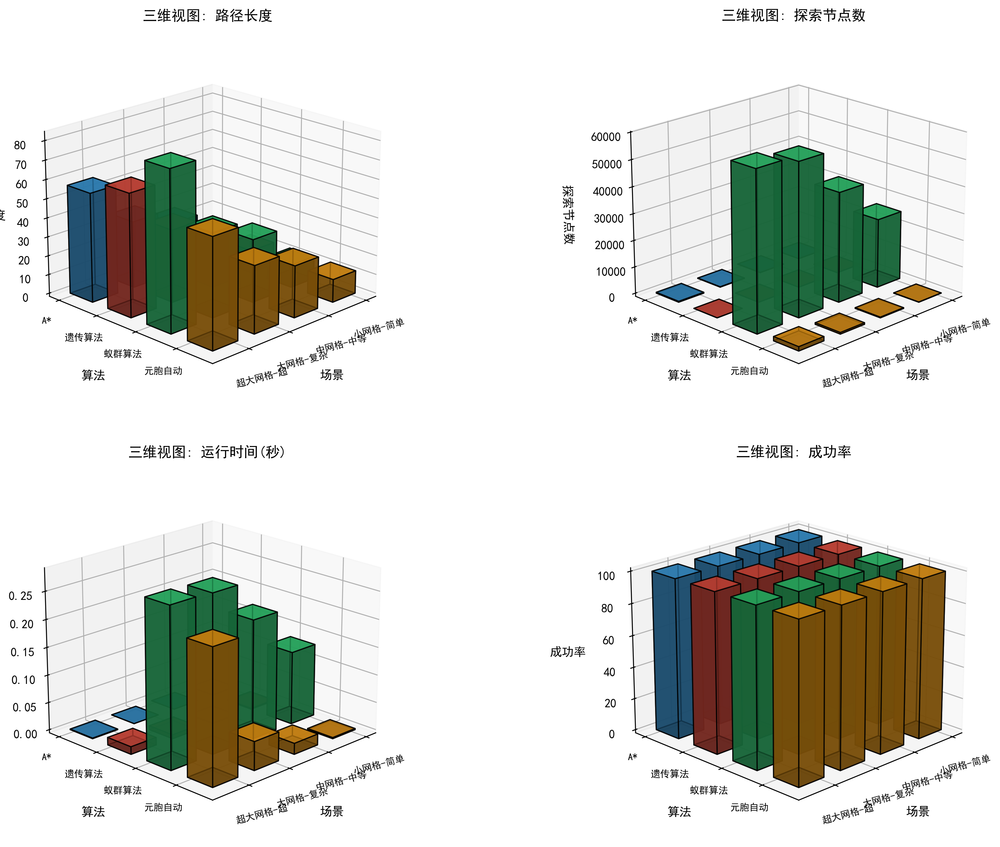
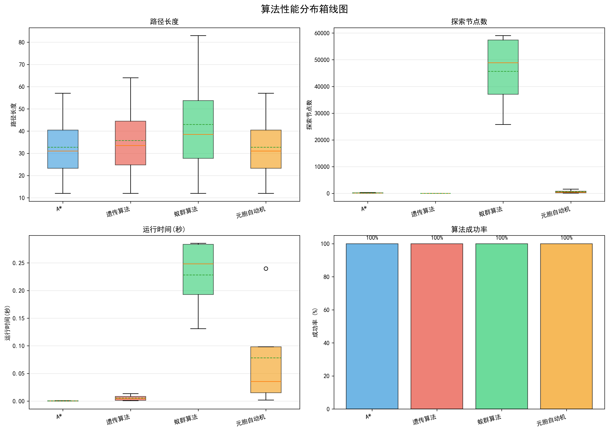
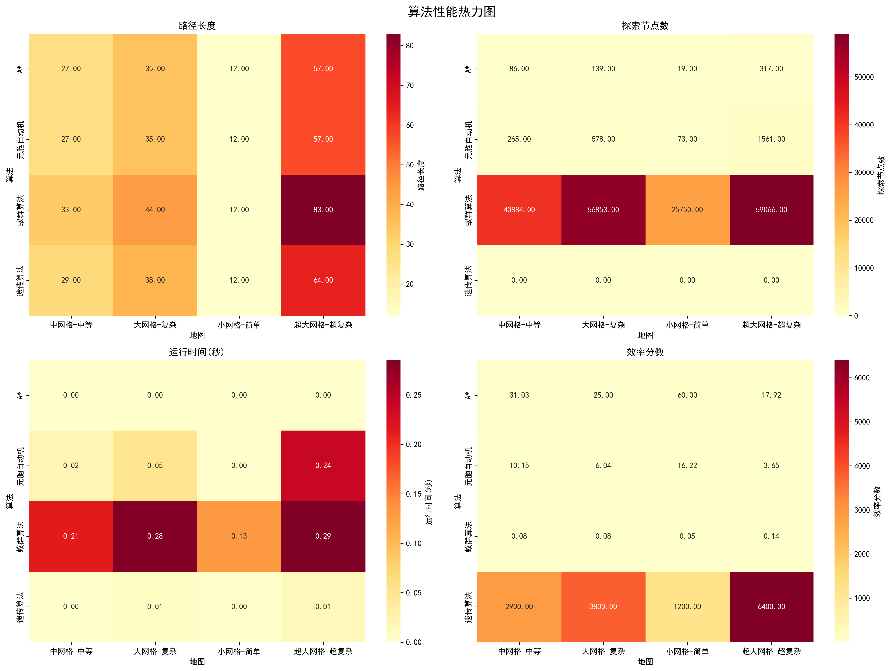
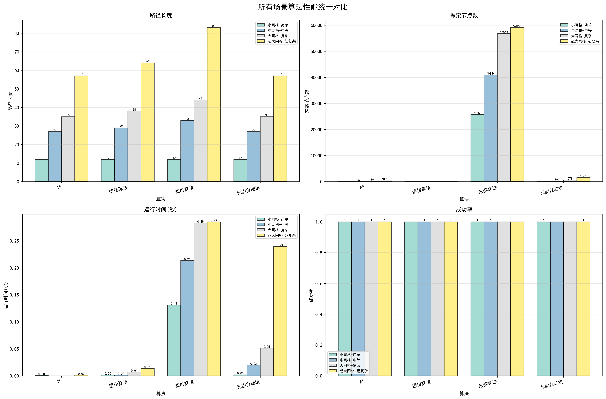
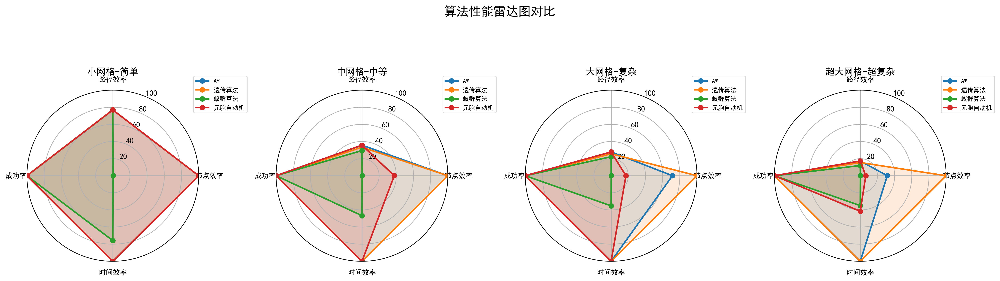

<!-- PAYMENT_BLOCK -->

## Get this dataset

- Payment link (Stripe): [Buy now](https://buy.stripe.com/3cs8yP7sY87d0vu9AB)
- Payment QR code: 

<!-- /PAYMENT_BLOCK -->
